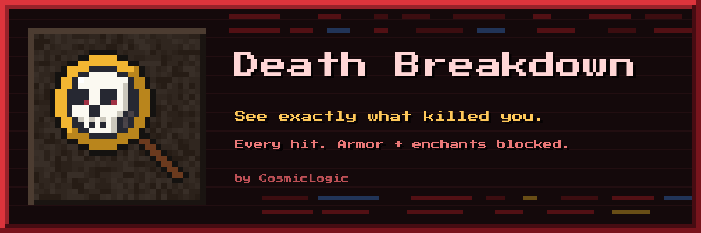
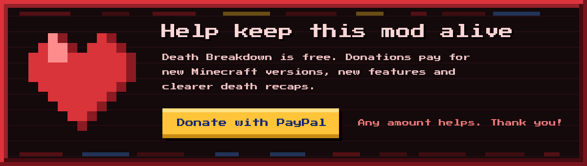

**Stop guessing. See exactly what killed you.**

You die, and the death message says "slain by Skeleton". But you were also on fire, fell off a ledge and got clipped by a creeper first. What actually happened? **Death Breakdown shows you, hit by hit.**

---

🧩 **Works with modded mobs, weapons and damage types too.**

## ▶️ How to use
1. Install it (on the server too, if you play multiplayer). No setup needed.
2. Die. The recap opens by itself on the death screen (or click **☠ Death Breakdown** in the corner).
3. Point at a row for every number. Press **K** any time to see it again, and **<** / **>** to look at your last few deaths.

## 🔥 What it does

### 💀 A recap the moment you die
A clean screen opens on the death screen with **every hit from your last 10 seconds**, oldest at the top and the **final blow** highlighted at the bottom.

### 🗡️ Who or what hit you
The mob, player, arrow, block or effect, plus the **weapon** they were holding ("Zombie (Iron Sword)", "Skeleton (Arrow)").

### 🔥 What kind of damage
Melee, arrow, fire, lava, fall, explosion, magic, poison, wither, drowning and more. Modded damage gets a readable name too.

### 🛡️ What your armor and enchantments blocked
Every row shows how much your **armor** stopped and how much your **enchantments** (Protection, Blast/Fire/Projectile Protection, Feather Falling) stopped, **separately**. Resistance, absorption hearts and shields get their own column.

### ❤️ How close it was
See your health after every hit, and a one-line summary like *"Killed by Skeleton (Bow): 11❤ in 4 hits. Stopped: armor 3❤, enchants 1❤. Most damage: Lava."*

### 🔁 Open it again anytime
Press **K** to reopen your last recap, or use the **☠ Death Breakdown** button on the death screen.

### 📜 Your last few deaths *(new in 1.1.0)*
Your **last 5 deaths** are kept, even after you leave, reload or restart. Flip through them with **<** and **>**, or list them with `/db history` and click one.

### 💡 A tip for every death *(new in 1.1.0)*
One short line that sums it up: *"Lava did 80% of the damage."* or *"Your gear stopped 60% of the damage."*

### 📋 Copy it *(new in 1.1.0)*
The **Copy** button puts the whole recap on your clipboard as text, ready for Discord or a bug report.

### 🖥️ Works on servers
Put it on the server too and players with the mod get the full screen. Players without it can still join and get the recap in chat, with every hit in the hover text.

### ⚙️ Settings screen *(new in 1.1.0)*
Click **Config** in the mod list (or **Settings** in the recap) to change everything with a short explanation for each option: the time window (5–60 seconds), which columns you see, hearts or health points, whether it opens by itself, the chat summary, the tip line and how many deaths are kept. It's all saved in `config/deathbreakdown.properties`.

## 🎮 Controls
| Key | What it does |
|---|---|
| **K** | Open your last death recap |
| **Scroll** | Scroll when there are lots of hits |
| **Hover a row** | Every detail about that hit |

Change the key in Options → Controls → Key Binds.

| Command | What it does |
|---|---|
| `/db` (or `/deathbreakdown`) | Your last recap |
| `/db history` | Your last deaths, click one to open it |
| `/db show <number>` | Open one from the history (1 = newest) |
| `/db copy` | Copy your last recap as text |
| `/db help` | All of this, in game |
| `/db player <name>` | Another player's last recap (ops) |
| `/db reload` | Reload the config and show anything that was wrong in it (ops) |

## 📦 Requirements
- **Forge:** Minecraft 1.12.2 to 26.3
- **NeoForge:** Minecraft 1.20.1 to 26.3
- **Paper:** get the plugin version here: [Death Breakdown Plugin](https://www.curseforge.com/minecraft/bukkit-plugins/death-breakdown-plugin)
- Pick the file for your Minecraft version and loader on the Files tab.
- Install it on the **client** for the recap screen, and on the **server** so the server can record your hits. Singleplayer just works.

Source and bug reports: https://github.com/CosmicLogic0/deathbreakdown

---

## ❤️ Support the mod

Death Breakdown is free. Donations keep the mod up to date with fixes, new Minecraft versions and new features. [Donate with PayPal](https://www.paypal.com/paypalme/DylanEMason) - any amount helps. Thank you!

---

## 🎮 Play on the creator's server
**Logic Survival** (`play.logicsurvival.fyi`) is the survival server run by the maker of this mod. Death Breakdown does **not** add it (or anything else) to your Multiplayer server list. Add it yourself if you'd like to visit.
